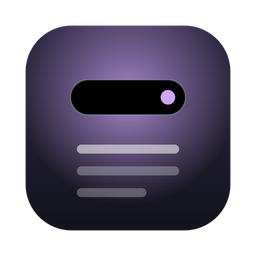
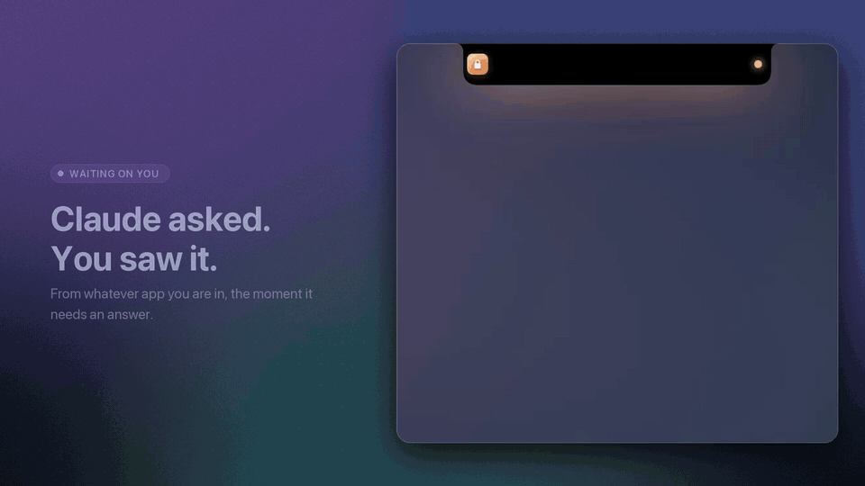

<p align="center">
  
</p>

<h1 align="center">Claude Island</h1>

<p align="center">
  <b>Your Claude Code sessions, living in the notch.</b><br>
  A Dynamic Island for the Mac: questions, permission requests, finished runs, your next meeting and every running session, without leaving the app you are in.
</p>

<p align="center">
  <a href="docs/demo.mp4"></a><br>
  <sub>Everything above is the real app running on made-up data. <a href="docs/demo.mp4">Watch the full video (20 s)</a>.</sub>
</p>

---

## What it does

| | |
|---|---|
| **Banners in the notch** | Claude asks a question, wants to run a command, or finishes: the island morphs out of the notch, shows what happened and the session it belongs to, and tucks itself away again. No sound. |
| **Overview** (`Ctrl-Option-C`) | Every session at a glance: live activity ("Editing CheckoutSheet.tsx"), who is waiting for you, grouped by Claude account with the 5-hour and weekly usage limits. |
| **Task queues** | Line up tasks per session. Profiles *Continue*, *Verify* (tests and lint must pass) and *Ship* (verify, then commit, never push). A task only counts as done when Claude ends with `QUEUE: DONE`; anything else hands the session back to you. |
| **Your tasks** (`Ctrl-Option-T`) | A personal to-do list kept in the "Claude" list of Apple Reminders, so it also reaches your iPhone. Hand a task to a session with one click. |
| **Meetings and chat** | Next meeting from Calendar (one click to join the call), plus Google Chat / Gmail notifications as banners. |
| **Click to jump** | Click a session and its own Zed window and terminal tab come to the front. Other terminals are focused by app. |
| **Quiet by design** | Respects Focus, Zoom screen sharing, `CLAUDE_QUIET=1` and a global `~/.claude/notifier/quiet` file. On a Mac without a notch it draws one. |

## Install

Needs macOS 14+, the Xcode command line tools (`xcode-select --install`) and Claude Code. Built and tested on current macOS with a notched MacBook and an external display.

```bash
git clone https://github.com/lukaas-jopcik/claude-island.git
cd claude-island
./scripts/install.sh
```

The script builds the app, installs it to `~/Applications`, copies the hooks to `~/.claude/hooks`, and starts it at login with a LaunchAgent. It never edits your Claude Code settings. Merge [`hooks/settings-snippet.json`](hooks/settings-snippet.json) into `~/.claude/settings.json` (or the `settings.json` of each Claude config dir you use) to feed the island its events:

| Hook | Does |
|---|---|
| `SessionStart`, `UserPromptSubmit`, `SessionEnd` | `session-state.sh` records whether a session is working, waiting or gone |
| `PreToolUse` | `activity.sh` writes the one-line "what is it doing now" |
| `Notification` | `notify.sh` turns questions and permission requests into banners |
| `Stop` | `stop.py` advances the task queue, then fires the "done" banner |

Optional permissions, asked only when you use the feature: Calendar (meetings), Reminders (Tasks tab), Full Disk Access (read Google Chat notifications from Notification Center), Accessibility (exact Zed tab jump).

Uninstall with `./scripts/uninstall.sh`.

## Privacy

Everything is local. The island reads files your hooks write under `~/.claude`, and nothing leaves your Mac except one call: the usage bars ask `api.anthropic.com/api/oauth/usage` with the Claude Code token already in your login Keychain (read only, never refreshed or stored). Calendar, Reminders and Notification Center are read through the system permission prompts above. Message and meeting titles are only ever shown, never written to disk.

## Demo mode and the video

`ISLAND_DEMO=1` runs the app against a fixture home (`ISLAND_HOME`) with made-up sessions, queues, accounts and meetings, and switches off Keychain, Calendar, Reminders, Notification Center and Zed. That is how the demo video was recorded, so no personal data is ever on screen.

```bash
./scripts/build.sh                  # build/Claude Island.app
# quit your own Claude Island first, then:
./demo/record.sh                    # scripted storyline -> demo/raw.mov (needs Screen Recording permission)
python3 demo/build_video.py         # docs/demo.mp4, demo.gif, poster.jpg (needs ffmpeg and Pillow)
```

## Repository

```
Sources/   the app: Island (banner, shape, animation), Overview, Tasks, Usage, Ambient (calendar), Alerts, ZedJump, GlassToast
hooks/     Claude Code hooks and the queue helper (bash and python, no dependencies)
scripts/   build, install, uninstall
demo/      fixture, backdrop, recording script, video builder
docs/      demo video, gif, poster
```

## Notes

- The app is a single SwiftUI/AppKit process (no dependencies beyond the system frameworks). State is plain JSON files, so it is easy to inspect: `~/.claude/session-state`, `~/.claude/island/queues`, `~/.claude/notifier/events`.
- The jump-to-session feature reads Zed's local state database and is Zed-specific. Everything else works with any terminal.
- Not affiliated with Anthropic. "Claude" and "Claude Code" are Anthropic's trademarks.

## License

[MIT](LICENSE)
